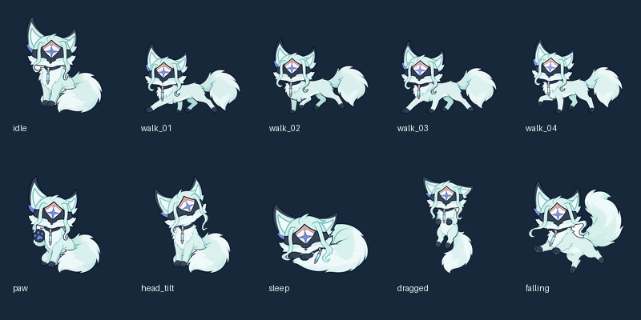

# 多托雷 AI 桌宠（Zandik）

当前版本：**2.0.0-animal.1 — 薄荷色狐狸形态**。所有旧桌宠动作贴图已换成新动物图，暂时禁用爬墙、挂天花板及跳墙入口。旧版保存在 Git 标签 `pre-animal-20260908`。



本轮改动、离线测试与恢复方式见 [动物版说明](docs/animal_release.md)。

基于开源 [Shimeji](https://github.com/Group-Finity/Shimeji-ee) 桌宠引擎开发的 **Windows 桌面宠物**，并接入 AI 对话系统，让桌面上的小人以《原神》角色 **多托雷（Il Dottore）** 的口吻与你对话、查阅资料、记住与你相关的事。

> 所有界面文字与说明均使用简体中文；Shimeji 引擎的动作/行为配置为日文 XML。

---

## ✨ 功能特性

- **动物形态桌宠行为**：四帧走路/跑动、坐下、歪头、抬爪、蜷睡、拖起和落地；原爬墙入口已注释，动作由 `conf/Actions.xml` 与 `conf/Behavior.xml` 驱动。
- **AI 角色扮演对话**：点击小人或右键菜单「对话」打开聊天窗口，AI 以多托雷的冷静、傲慢、缺乏常规共情的口吻回复（默认简体中文，称呼用户为「旅行者」）。
- **RAG 角色知识检索**：把 `character/` 下的角色设定与原文资料分块、做 TF-IDF 索引，按当前对话动态检索最相关素材拼进提示词，让语气与设定更贴合原作。
- **长期记忆（SQLite）**：每轮对话结束后立即把会话增量写入数据库（即使直接结束进程也不会丢），并自动抽取结构化长期记忆（身份、偏好、事件、项目、关系、指令），跨会话保留；重启后记忆仍在。
- **本地 / 远程双后端**：当前使用远程 DeepSeek API；保留可选 Ollama 接口。本次换图不改变模型、人设或长期记忆。
- **Agent 工具调用**：远程后端可让 AI 调用工具（只读文件、列目录、查系统信息、网页搜索/抓取、获取当前活动窗口、控制小人转身等）。

---

## 🖥️ 运行环境

| 项目             | 要求                                                                               |
| ---------------- | ---------------------------------------------------------------------------------- |
| 操作系统         | Windows（依赖 JNA 访问 Win32 API）                                                 |
| Java             | **JDK / JRE 8**（编译 `source/target 8`，启动脚本固定为 `jre1.8.0_441`） |
| 构建工具         | Apache Ant（无 Maven/Gradle）                                                      |
| 本地模型（可选） | [Ollama](https://ollama.com/) + `dottore:7b` 模型                                 |

---

## 🚀 快速开始

### 1. 直接运行（已打包）

从 GitHub 首次下载时，复制 `conf/chat_config.example.properties` 为 `conf/chat_config.properties`，填入自己的 `api.key`。如果直接从 `dist` 目录运行，也要在 `dist/conf/` 下创建同名配置。本机已有配置不用覆盖。仓库不包含密钥、聊天记录和记忆数据库。

```bat
启动多托雷.bat
```

该脚本会：

1. 若配置为 `ai.provider=ollama` 且 Ollama 未运行，则静默启动 `D:\soft_system\Ollama\ollama.exe serve`；
2. 用 `javaw` 启动 `dist\Shimeji.jar`。

也可以用命令行直接运行：

```powershell
java -Dfile.encoding=UTF-8 -jar dist\Shimeji.jar
```

### 2. 从源码构建

本版本推荐使用 JDK 8 运行已包含离线测试的构建脚本：

```powershell
powershell -NoProfile -ExecutionPolicy Bypass -File tools/build_animal.ps1
```

无需重新绘图或运行抠图脚本，透明 PNG 已在仓库中。传统 Ant 构建方式仍保留：

```powershell
ant            # 编译 + 打包 dist/Shimeji.jar，并复制 conf/img/lib/character 资源到 dist/
ant run        # 构建后直接运行（工作目录为 dist/）
ant compile    # 仅编译到 build/
ant clean      # 清空 build/ 与 dist/
```

> ⚠️ **工作目录很关键**：程序通过 `System.getProperty("user.dir")` 加载 `conf/`、`img/`、`lib/`、`character/`。修改了这些目录下的文件后，请重新 `ant` 同步到 `dist/` 再运行。

---

## ⚙️ 配置

主配置文件：`conf/chat_config.properties`（发布版位于 `dist/conf/chat_config.properties`）。

```properties
# AI 后端：ollama=本地模型，api=远程 API
ai.provider=api

# Ollama 本地模型
ollama.endpoint=http://127.0.0.1:11434/v1/chat/completions
ollama.model=dottore:7b
ollama.read_timeout_seconds=180

# 远程 API（仅 ai.provider=api 时使用）
api.endpoint=https://api.deepseek.com/anthropic/v1/messages
api.model=deepseek-v4-flash
api.key=你的密钥

# 对话上下文条数
max.history=16

# RAG 检索
rag.enabled=true
rag.top_k=4
rag.min_similarity=0.01

# SQLite 长期记忆
memory.enabled=true
memory.retrieve_top_k=8
```

关键行为：

- **`ai.provider`** 决定后端。`ollama` 使用 OpenAI 兼容格式访问本地模型；`api` 使用 **Anthropic 格式**（`endpoint` 含 `anthropic`）访问 DeepSeek，并启用工具调用。
- 界面尺寸、缩放、透明度、字体等在 `conf/settings.properties`（运行时可从托盘/右键菜单「设置」修改）。
- `conf/Actions.xml`、`conf/Behavior.xml` 为 Shimeji 动作与行为定义（日文），对应 schema `conf/Mascot.xsd`。

---

## 🎭 自定义角色人设

角色资料统一放在 `character/` 目录：

| 路径                                                     | 作用                                             |
| -------------------------------------------------------- | ------------------------------------------------ |
| `personality.txt` / `background.txt` / `rules.txt` | 核心性格、背景、行为规则（始终进入提示词）       |
| `dialogue_examples.txt`                                | 对话示范                                         |
| `analysis/`                                            | 编号的人物深度分析（如`01_core_identity.txt`） |
| `sources/`                                             | 原文考据、台词、剧情文本（RAG 检索素材）         |
| `memory/`                                              | SQLite 长期记忆数据库与会话 JSON 备份            |

修改角色文本后，程序启动时会检测文件指纹并**自动重建 RAG 索引**（`character/rag_index.json`），无需手动操作。

### 可选本地模型提示词定制（Ollama，并非权重微调）

专用模型定义在 `ollama/Modelfile`，基于 `qwen2.5:7b` 并加入角色锁、示范对话、8192 上下文与较低随机性。修改后重建模型：

```powershell
& "D:\soft_system\Ollama\ollama.exe" create dottore:7b -f ".\ollama\Modelfile"
```

`ai.provider=api` 时无需本地模型。当前仍使用 API；Ollama 是可选方案。详见 [docs/local_model.md](docs/local_model.md)。

---

## 🧠 长期记忆数据库

数据库文件（首次启动自动创建）：

```
character/memory/dottore_memory.db    # 源码目录运行时
dist/character/memory/dottore_memory.db  # 发布版运行时
```

- 启用了外键、WAL、`busy_timeout=5000`。
- 正式表使用英文 `snake_case` 字段，另通过 `schema_dictionary` 数据字典表与 `memory_items_zh` 只读视图保留中文说明（SQLite 不支持 MySQL 的 `COMMENT`）。
- 历史会话迁移按 UTF-8 严格解码，失败回退 GB18030；新会话统一 UTF-8 写入。
- 查询示例：

```powershell
& 'D:\soft_system\SQLite\sqlite3.exe' -header -column -box '.\dist\character\memory\dottore_memory.db'
```

```sql
.tables
SELECT * FROM memory_items_zh;
.quit
```

> 不要在桌宠运行时执行 `DROP TABLE` / `DELETE` 等结构或写操作；只读查询是安全的。详见 [docs/memory_database.md](docs/memory_database.md)。

---

## 🏗️ 项目结构

```
Zandik/
├── build.xml                 # Ant 构建脚本
├── 启动多托雷.bat            # 一键启动脚本
├── manifest.mf               # JAR 清单
├── src/com/group_finity/mascot/
│   ├── Main.java             # 入口：加载配置、托盘、初始化 AI、创建桌宠
│   ├── Manager.java          # 桌宠管理器（40ms 主循环 tick）
│   ├── Mascot.java           # 单个桌宠实体
│   ├── MascotEventHandler.java # 鼠标交互：单击开对话、拖拽、右键菜单
│   ├── action/               # 动作（走、跳、拖拽、分裂、投掷…）
│   ├── behavior/             # 行为状态机（UserBehavior）
│   ├── config/               # 解析 Actions.xml / Behavior.xml
│   ├── animation/            # 动画与姿态
│   ├── environment/          # 桌面环境（窗口边缘、地面、墙）
│   ├── win/                  # Windows JNA 原生实现
│   ├── generic/              # 跨平台回退实现
│   └── chat/                 # ★ AI 对话层（本项目核心）
│       ├── ChatManager.java        # 单例，串联所有 AI 组件
│       ├── AIClient.java           # HTTP 客户端，OpenAI/Anthropic 双格式
│       ├── ChatDialog.java         # Swing 对话窗口
│       ├── CharacterLoader.java    # 加载 character/ 人设
│       ├── ChunkSplitter.java      # 文本分块
│       ├── TFIDFIndex.java         # TF-IDF 向量索引 + 余弦检索
│       ├── RAGPromptBuilder.java   # 拼接 system prompt
│       ├── ConversationHistory.java# 会话历史
│       ├── LongTermMemoryStore.java# SQLite 长期记忆
│       └── MascotTool.java         # Agent 工具定义与执行
├── conf/                     # 配置（Actions/Behavior/chat_config/settings）
├── character/                # 角色人设、资料、记忆
├── img/                      # 角色帧图（shime1.png …）
├── lib/                      # 依赖 jar（JNA、gson、sqlite-jdbc…）
├── tests/                    # 独立 main() 自测（无 JUnit）
├── docs/                     # 本地模型与记忆数据库说明
└── dist/                     # 打包输出（含一份运行时资源副本）
```

---

## 🧪 测试

没有 JUnit，也没有 Ant 测试目标。测试是 `tests/` 下独立的 `main()` 类（包名 `com.group_finity.mascot.chat`），需手动编译运行：

```powershell
javac -encoding UTF-8 -cp "build;lib/*" -d build tests\<Name>.java
java -cp "build;lib/*" com.group_finity.mascot.chat.<Name> [args]
```

| 测试类                            | 是否需 AI    | 说明                                  |
| --------------------------------- | ------------ | ------------------------------------- |
| `RagIndexSelfTest`              | 否           | 校验随包发布的 RAG 索引与语料哈希一致 |
| `MemoryStoreSelfTest`           | 否           | SQLite 长期记忆存取/去重/检索         |
| `RebuildRagIndex`               | 否           | 离线重建`character/rag_index.json`  |
| `LocalCharacterIntegrationTest` | 是           | 联调配置 + 人设 RAG + SQLite 记忆     |
| `DottoreToneSelfTest`           | 是           | 断言不出现「温柔助手」措辞            |
| `LocalOllamaSelfTest`           | 是（Ollama） | 本地 Ollama 端到端对话 + 结构化记忆   |

---

## ⚠️ 注意事项

- `conf/chat_config.properties` 中可能包含真实 API Key，**请勿外泄**；提交前建议替换为占位符。
- 本地 7B 模型无法完全装入 4GB 显存，部分计算会落到 CPU/内存，首次回答与长上下文较慢。
- 程序重启不恢复旧聊天窗口，但长期记忆会保留。
