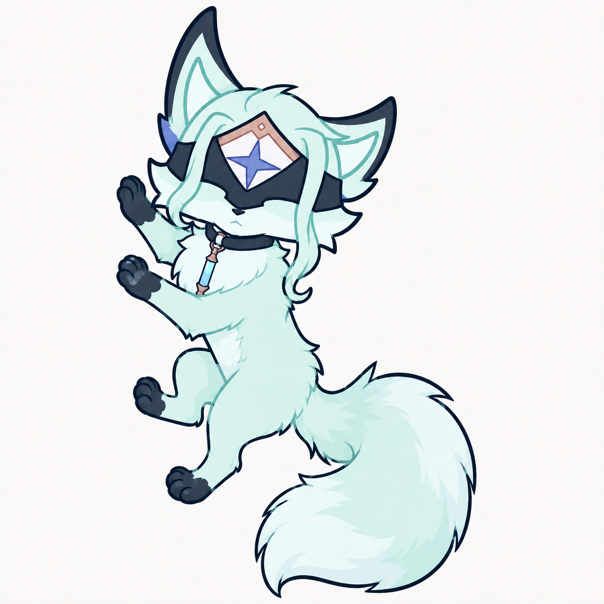
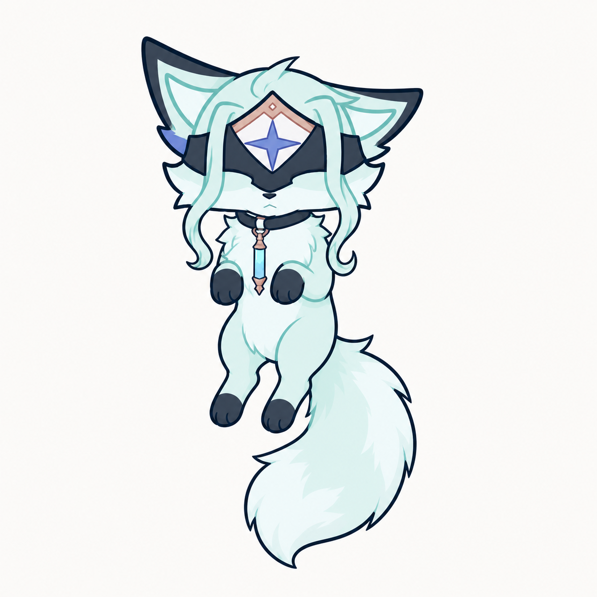
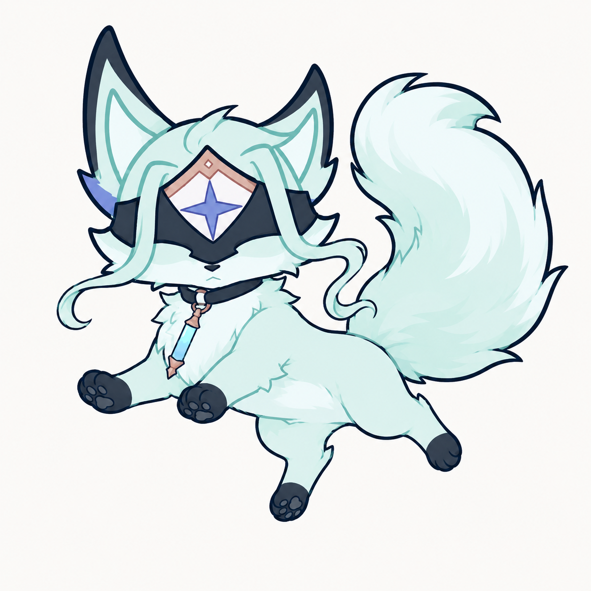
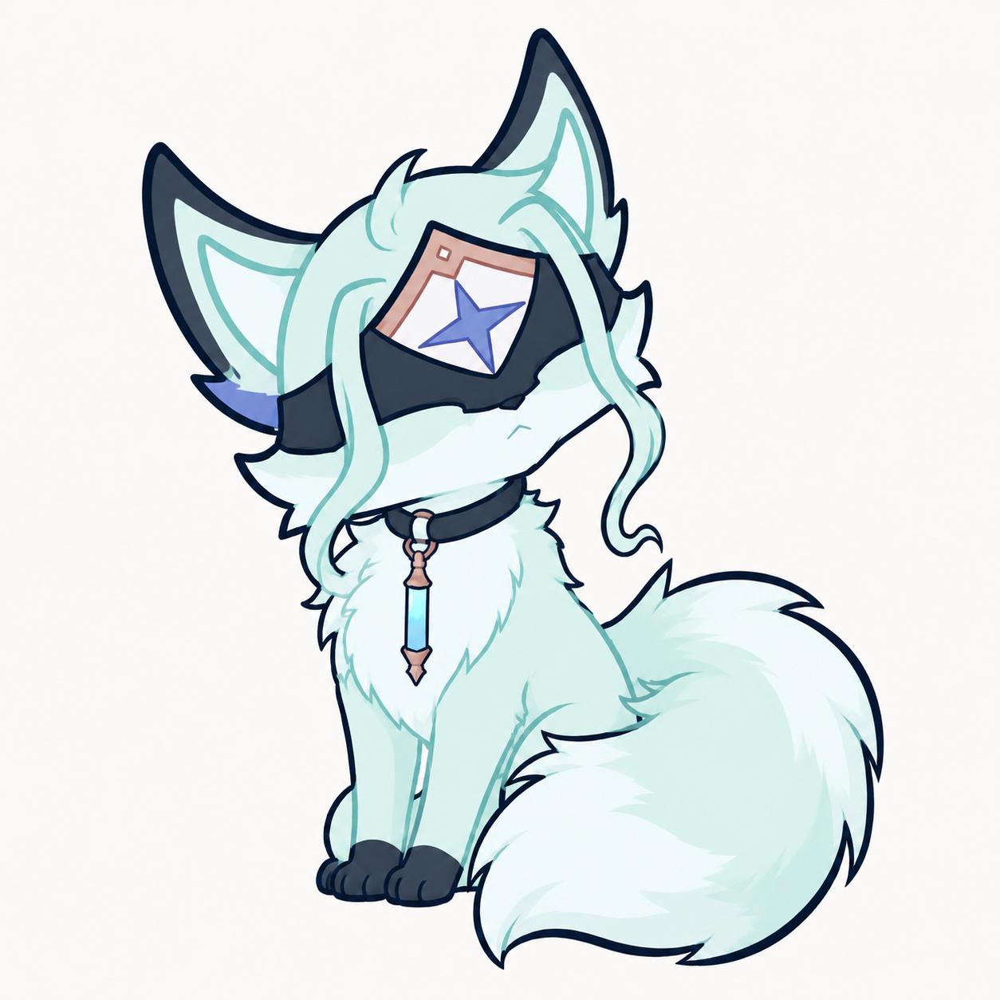
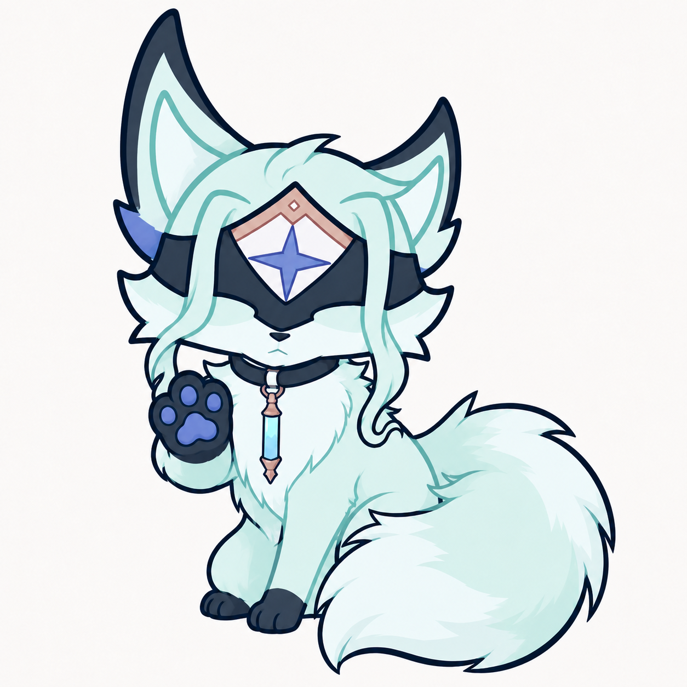
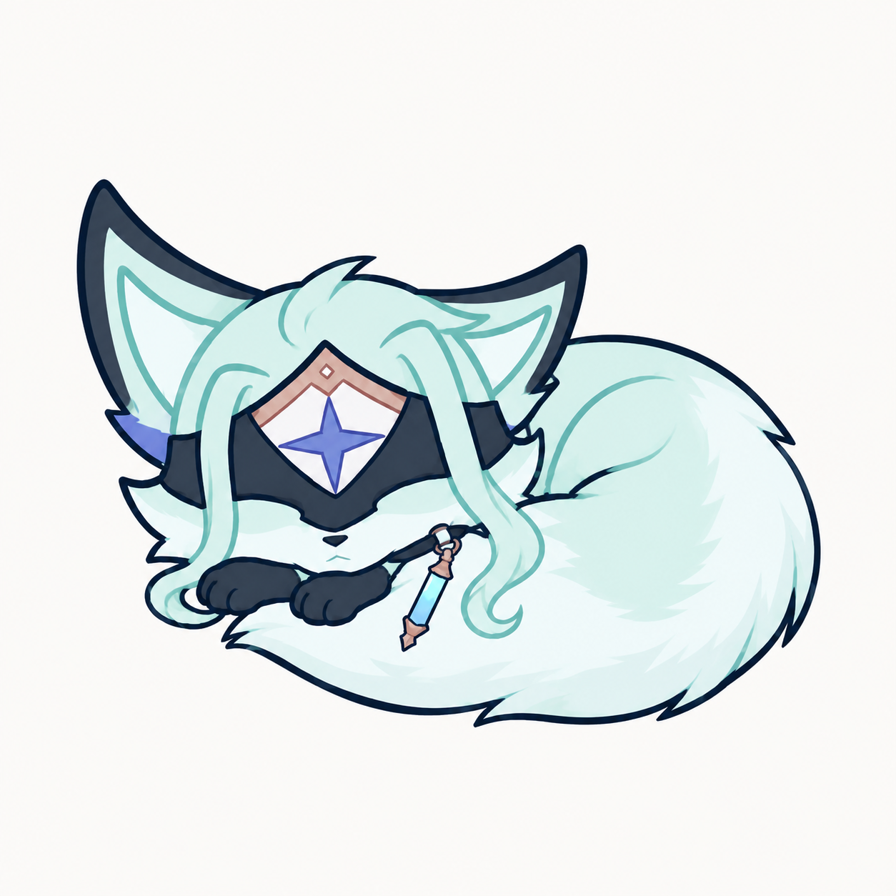
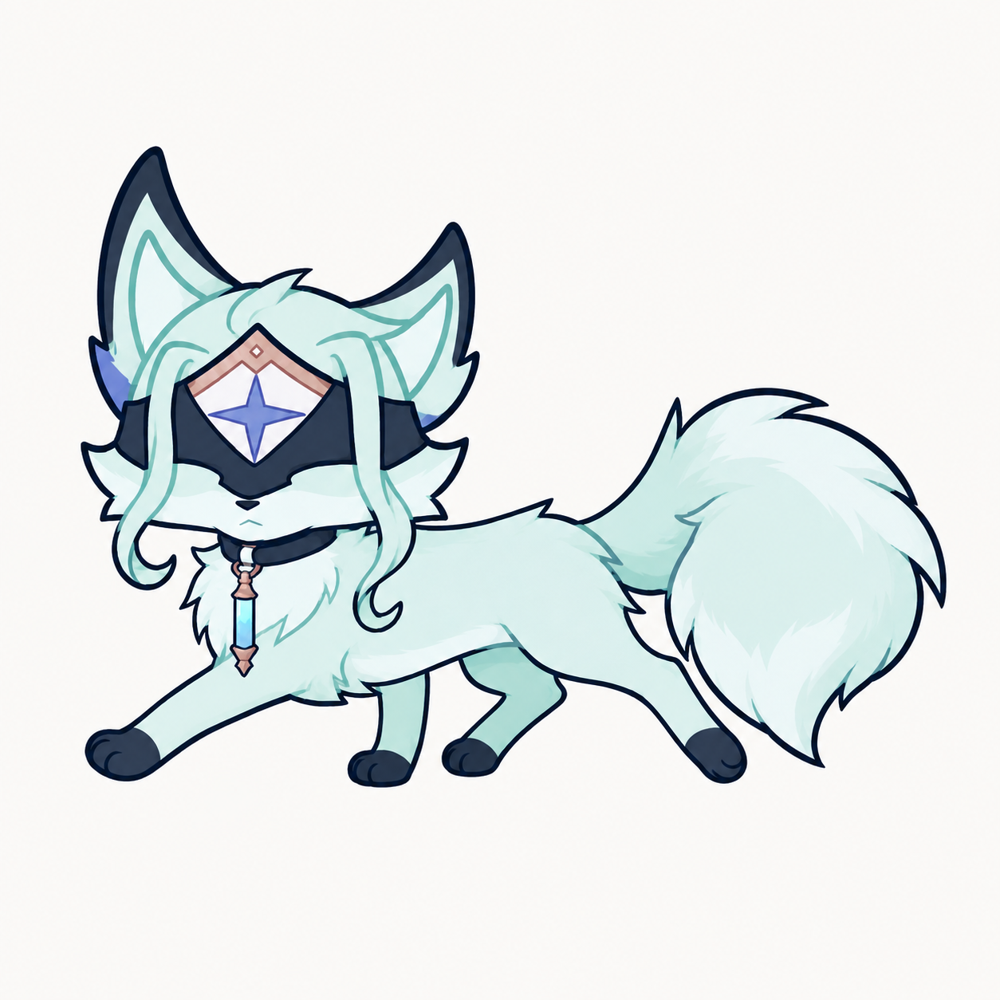
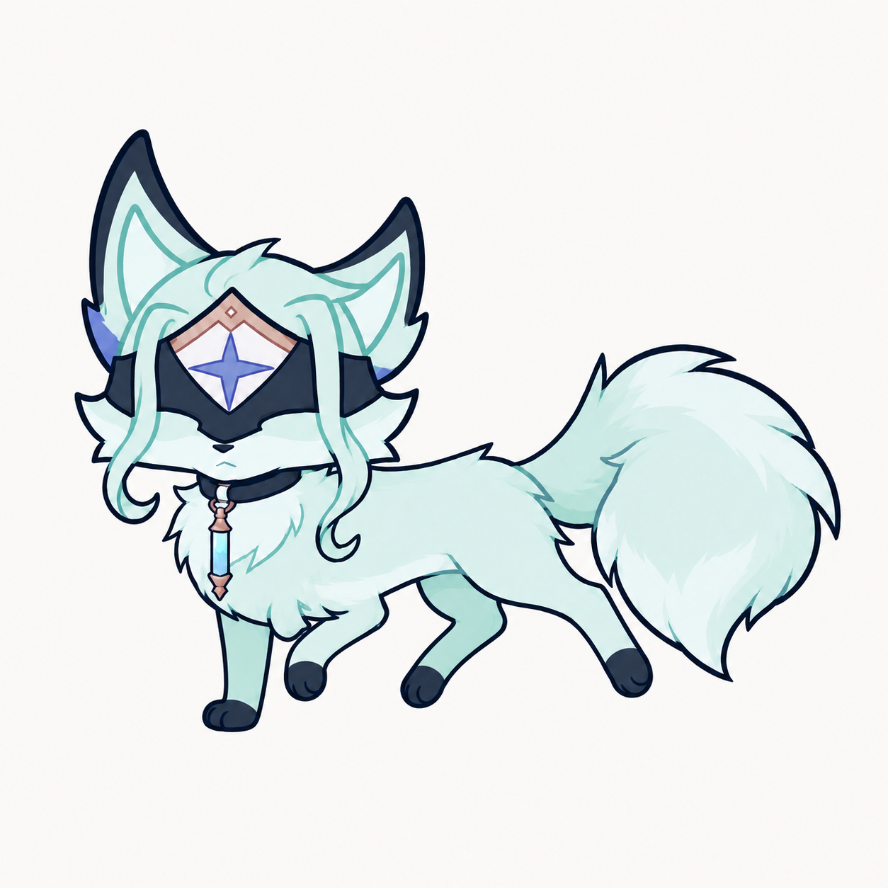
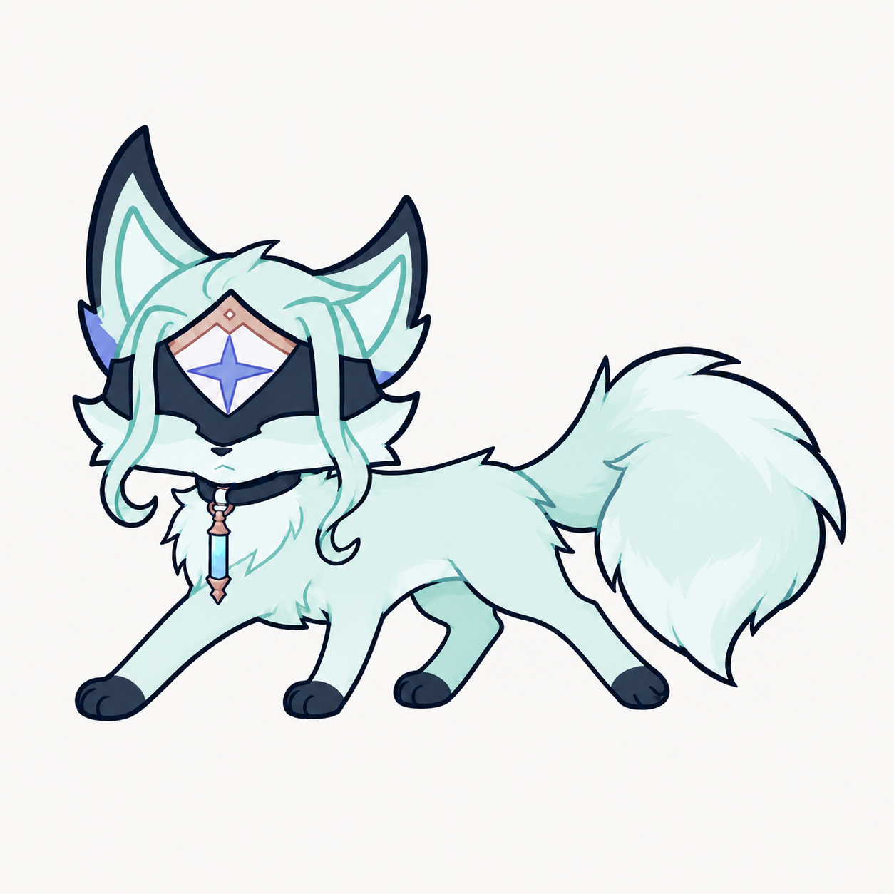
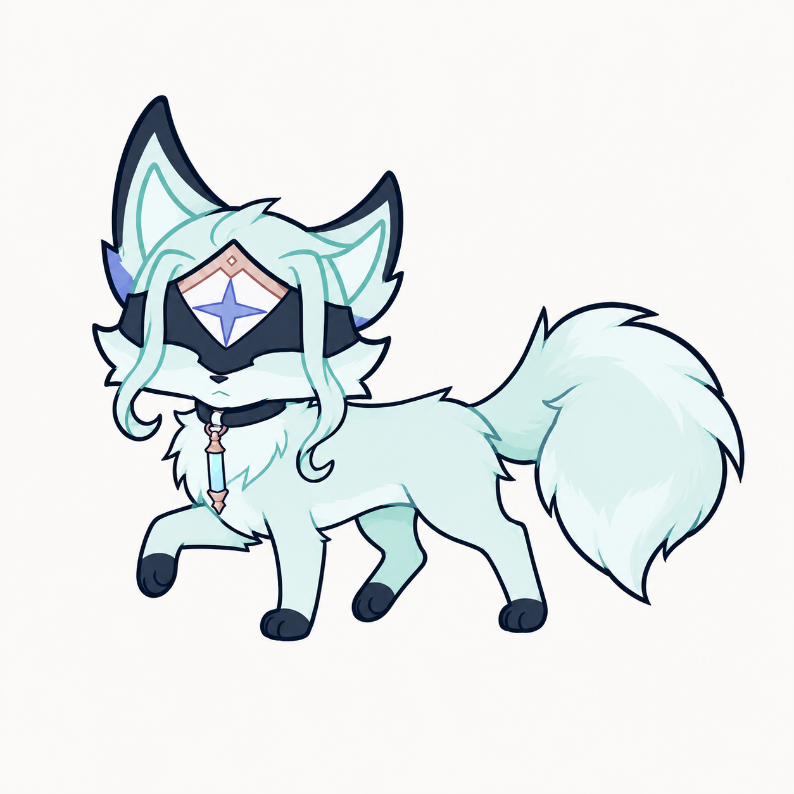

# 多托雷狐狸形态 · 动作造型稿

使用内置 image_gen 绘图工具，沿用上一版造型生成。所有图片为 1254 × 1254 白底 PNG，未替换运行中的桌宠素材。

包含四张走路姿势变化和六张其他动作。这些是动作设计稿，不是已经对齐、可直接循环播放的动画帧：步态接触时序、前后腿层次、头身位置与大小、耳朵左右不对称性仍需在动画制作时校准。接入前还需制作透明背景和匹配动作锚点。

## 爬墙

## 被拖起

## 下落

## 互动 · 歪头观察

## 互动 · 抬爪

## 睡觉 · 蜷尾

## 走路 · 迈步

## 走路 · 收腿

## 走路 · 支撑变化

## 走路 · 抬爪

